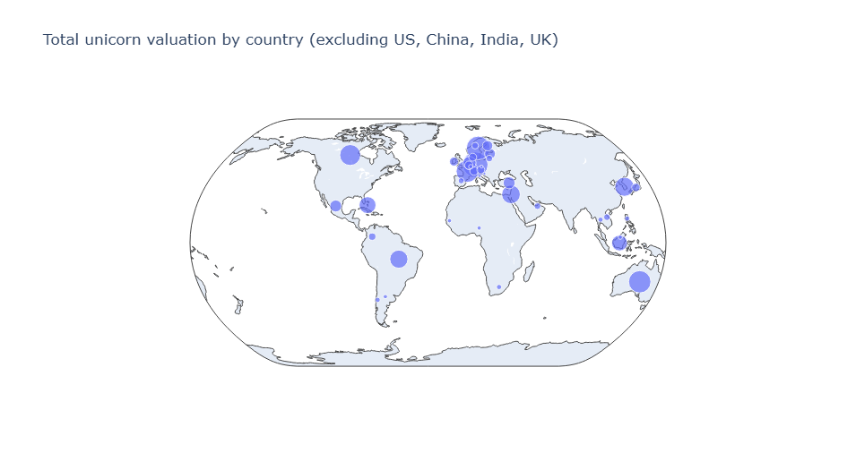

# Unicorn Companies EDA

Exploratory data analysis of unicorn companies (private companies valued at $1B or more) using Python.

## Notebooks
- `01_discover_dataset.ipynb`: data cleaning, sampling, and visualizing time to unicorn status and valuation by industry
- `02_structure_and_visualize.ipynb`: feature engineering (month, quarter, years to join), box plots, and 2020 vs. 2021 comparisons
- `03_address_missing_data.ipynb`: finding and handling missing values (dropping vs. imputing), filtering by investor criteria, and valuation maps by country
- 04_validate_and_clean_data.ipynb: input validation (bad values, inconsistent labels, duplicates) and converting numeric and categorical data (binning with qcut(), ordinal, label and dummy encoding)

## Tools
Python, pandas, numpy, seaborn, matplotlib, plotly, Jupyter Notebook

## Key findings
- Most unicorns were founded between 2010 and 2016, peaking in 2015
- The month a company joined had little effect on time to unicorn status
- Weekly unicorn counts in 2021 peaked in week 28
- Average valuation at joining was lower in 2021 than in 2020 in every quarter
- Missing values were not random: 15 of the 16 missing cities belong to Singapore and Hong Kong
- Dropping rows with missing values removed 1.58% of the data, while dropping columns removed 16.67%
- Total valuation is concentrated in the US ($1,933B), followed by China, India and the UK
- Validation found a wrong founding year for InVision (giving a negative time to unicorn), three misspelled industry labels, and three duplicated companies (BrewDog, ZocDoc, SoundHound)
Encoding method depends on the variable: ordinal for continent, label encoding for country, dummy variables for industry

## Map

## Data
Dataset: [Unicorn Companies](https://www.kaggle.com/datasets/mysarahmadbhat/unicorn-companies) by M. A. Bhat (Kaggle). Notebooks read `Unicorn_Companies.csv`.
Modified_Unicorn_Companies.csv
